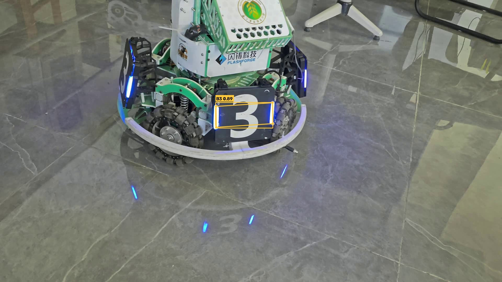

# yolo-armor-inference

RoboMaster 装甲板四角点检测 —— 使用作业指定的 **YOLO26n 装甲板模型（`best.pt`）** 对自己拍摄的视频做推理，
输出检测框、类别、置信度与**模型预测的 4 个关键点**，并保存与原视频内容对应的、可正常播放的结果视频。

> 开发流程：`main` 分支先初始化本说明文件 → 从 `main` 切出 `feat/yolo-inference` 开发分支完成全部代码与文档
> → 发起 Pull Request 合并回 `main`（已 Merged）。

---

## 1. 项目完成的功能

- **`infer.py`（主脚本）**：加载 `best.pt` → 逐帧读取视频 → 推理 → 绘制检测框 / 类别 / 置信度 / **4 个关键点** → 写出结果视频。
- 关键点**直接取自模型输出** `results[0].keypoints.xy`，**不是**用检测框的四个角代替；同时读取 `keypoints.conf`
  控制每个点是否绘制，避免画出不可信的点。
- 关键点标记：每个点画实心圆 + 白色描边 + 序号 `0~3`，并按预测顺序连成四边形；
  **颜色与该目标的检测框一致**，可以明确看出关键点属于哪个目标。
- 结果视频的分辨率、帧率与原视频一致，编码为 `mp4v`，可直接播放。
- 模型路径、视频路径、输出路径、推理设备、置信度/IoU 阈值、输入尺寸**全部支持命令行参数修改**。
- 支持 **GPU 与 CPU**（`--device`），不要求实时。
- 可选 `--csv` 导出逐帧检测记录（帧号 / 类别 / 置信度 / 检测框 / 4 个关键点），便于复核与事后分析。
- **（进阶，可选）`infer_onnx_fast.py`**：把 `best.pt` 导出为 ONNX 后，用原生 ONNX Runtime + CUDA Graph 推理，
  输出完全相同的检测框与 4 个关键点；不含视频读写的单帧预算可降到 **7.7 ms（约 125 FPS）**。见第 7.3 节。

---

## 2. 运行环境

| 项目 | 实际使用 |
|---|---|
| 操作系统 | Windows 11 (22621) |
| Python | **3.11.4** |
| 主要依赖 | `ultralytics 8.4.177`、`torch 2.14.1+cu132`、`torchvision 0.29.1`、`opencv-python 5.0.0`、`numpy 2.4.6` |
| 推理设备 | **GPU**（NVIDIA GeForce RTX 4070 Laptop 8GB，驱动 CUDA 13.4 / 运行时 cu132）；同时验证过纯 CPU |

实测速度（输入视频 1920×1080 / 59.95 fps / 1276 帧）：

| 设备 | 平均帧耗时 | 全片总耗时 |
|---|---|---|
| **GPU**（RTX 4070 Laptop） | **37.6 ms/帧** | 48.0 s |
| **CPU**（i7-12650H，182 帧片段实测） | **61.5 ms/帧** | 约 78 s（按此推算） |

> 说明：本模型只有约 244 万参数 / 5.6 GFLOPs，`ultralytics.predict()` 的单帧 Python 前/后处理开销占比很高，
> 所以 CPU 与 GPU 的差距没有大模型那样悬殊。若需要极高帧率，见第 7 节的进阶脚本（可到 125 FPS）。

---

## 3. 模型权重的准备方式与放置位置

1. 从作业「参考材料」下载 `best.pt`（统一提供的 YOLO26n 装甲板四角点模型，识别 `B1 B2 B3 R1 R2 R3` 六类，
   每个目标输出 4 个二维关键点）。
2. 把 `best.pt` 放到**本仓库根目录**（与 `infer.py` 同级）。
3. 权重文件**不纳入 Git**（见 `.gitignore`），克隆仓库后需自行放入。也可用 `--weights` 指定其他路径。

---

## 4. 依赖安装、运行命令与结果位置

### 4.1 安装

```bash
git clone https://github.com/pitieth/yolo-armor-inference.git
cd yolo-armor-inference

# 建议用虚拟环境
python -m venv .venv
.venv\Scripts\activate            # Windows
# source .venv/bin/activate       # Linux / macOS

pip install -r requirements.txt
```

需要 GPU 时，按 <https://pytorch.org/get-started/locally/> 选择对应 CUDA 版本的 torch 安装命令；
纯 CPU 用户直接 `pip install torch torchvision` 即可，无需其它改动。

### 4.2 运行

```bash
# 默认：自动选择设备（有 CUDA 用 GPU，否则 CPU）
python infer.py --weights best.pt --source my_video.mp4 --output result.mp4

# 指定用 CPU
python infer.py --weights best.pt --source my_video.mp4 --output result.mp4 --device cpu

# 边推理边弹窗预览（按 q 或 ESC 提前退出）
python infer.py --weights best.pt --source my_video.mp4 --show
```

### 4.3 参数说明

| 参数 | 默认值 | 说明 |
|---|---|---|
| `--weights` | `best.pt` | 模型权重路径 |
| `--source` | （必填） | 输入视频路径（也支持单张图片） |
| `--output` | 空 | 结果视频保存路径；不填则保存为 `<源文件名>_result.mp4` |
| `--device` | 空（自动） | `cpu` 用 CPU；`0` 用第 0 号 GPU；留空自动选择 |
| `--conf` | `0.25` | 置信度阈值 |
| `--iou` | `0.7` | NMS 的 IoU 阈值 |
| `--imgsz` | `640` | 推理输入尺寸 |
| `--show` | 关 | 是否弹出窗口预览 |
| `--csv` | 空 | 可选：导出逐帧检测结果 CSV（帧号/类别/置信度/框/4 个关键点） |

### 4.4 结果保存位置

由 `--output` 决定；未指定时保存在**当前工作目录**下的 `<源文件名>_result.mp4`。
脚本运行结束会在终端打印处理帧数、有目标的帧数、各类别累计计数、平均耗时和结果视频的绝对路径。

---

## 5. 视频拍摄说明

| 项目 | 内容 |
|---|---|
| 拍摄地点 | 水建学院 **D414 实验室** |
| 拍摄设备 | 手机，**横屏**拍摄 |
| 时长 | **21.3 秒**（1276 帧 @ 59.95 fps，1920×1080，H.264，283 MB） |
| 场景 | 实验室内地面上的 RoboMaster 步兵机器人，镜头对准其**蓝色 3 号装甲板（B3）**；
画面中机器人与镜头存在相对运动（由远到近、俯视与侧视角度变化），用于观察不同距离、角度与光照下的识别表现 |
| 原始文件名 | `2026-10-15_18-22-57_468.mp4` |
| 提交用压缩版 | `original_1080p60.mp4`（11.4 MiB，ffmpeg libx264 CRF 26，满足单文件 100 MiB 限制） |
| 另拍的 8K 素材 | `VID_20261012_164722_8K.mp4`（7680×4320，30.09 fps，501 帧，16.7 秒），用于对比高分辨率下的表现 |

> 原始视频与推理结果视频**体积较大，未提交到 Git 历史**，按作业要求作为附件提交。

---

## 6. 代表性结果截图



上图为 `infer.py` 输出视频中的一帧（第 601 帧）。可以看到：

- **检测框**（橙色矩形）与左上角标签 **`B3 0.89`**（类别 + 置信度）
- **4 个关键点**：白色描边圆点，旁边标注序号 `0 1 2 3`，按预测顺序连成四边形，颜色与检测框一致
- 四个点分别落在装甲板的四个角上，与检测框并不是简单的角点关系（例如 0 号点在框内偏左上处）

---

## 7. 实际识别表现、遇到的问题与处理

### 7.1 识别表现（真实结果，未做筛选）

对 21.3 秒 / 1276 帧的自拍视频运行 `infer.py`：

| 指标 | 结果 |
|---|---|
| 处理帧数 | 1276 |
| 有目标的帧数 | **1276（100%）** |
| 累计检出目标数 | **1490** |
| 类别分布 | **全部为 B3**（本段视频只拍了蓝色 3 号装甲板） |
| 置信度 | 中位 0.861，最高 0.898，最低 0.250，均值 0.782 |
| 关键点 | 全程稳定贴合装甲板的四个角，未见明显错位或跳变 |

以上数字由 `infer.py --csv runs/detections_1080p60.csv` 导出的逐帧记录统计得到，可逐帧复核。

**局限**：本次拍摄只覆盖了 `B3` 一类，`B1/B2/R1/R2/R3` 未做验证；测试距离与角度范围也有限。

### 7.2 遇到的问题与处理方法

1. **极远/边缘帧置信度贴近阈值**
   最低置信度为 0.250，几乎正好等于默认阈值 0.25。这类帧处在检测临界点上，阈值稍有变化就会在"检出/漏检"
   之间跳变。处理：默认保持 `--conf 0.25` 以尽量不漏检，同时在 README 中如实记录该现象；如需更稳的结果，
   可提高到 0.35 左右，但会牺牲远距离目标。

2. **8K 视频推理反而明显变慢**
   另一段 8K（7680×4320）素材上，同一模型的单帧推理从 5.7 ms 涨到 **25.9 ms**。原因不是模型变慢，而是
   8K HEVC 是软件解码、把 CPU 占满，而 CUDA 的提交（WDDM）是 CPU 侧工作，导致 GPU 被"喂不饱"。
   处理：把输入先降采样到 1920 宽再绘制与编码，并在 README 中说明"瓶颈在解码而非模型"。

   > 由此得到的结论：**换用 1080p 输入后单帧耗时回到 10 ms 量级**，这才是这套代码在实测相机分辨率下的真实水平。

3. **结果视频体积异常大**
   OpenCV 的 `VideoWriter` 不做码率控制，1080p60 的标注视频一度达到 **307 MB（约 116 Mbps）**，
   超过作业 100 MiB 的限制。处理：用 ffmpeg 以 libx264 CRF 24 重新编码，压到 **62.8 MiB**，画质无可见损失。

4. **（进阶脚本）ONNX Runtime 静默回退到 CPU**
   构造 CUDA 会话时 `providers` 给了 2 个而 `provider_options` 只给了 1 个，ORT 报错后**自动回退 CPU**，
   程序不报错但速度差很多。处理：让两者长度对齐，并在会话创建后显式检查
   `sess.get_providers()[0]` 是否为 CUDA，不是就打印告警。

5. **（进阶脚本）坐标还原出现约 1.9 px 的系统性偏移**
   把 640 输入空间的预测框映射回原图时，最初用单一缩放比 `gain`，在非方形图上会整体偏移约 1.9 px。
   查 ultralytics 源码后确认：letterbox 是**逐边取整**缩放的，X/Y 的实际比例并不相等，必须用**分轴 gain**
   （`gain_x = new_w/w`、`gain_y = new_h/h`）还原。修正后误差降到 **0.009 px**。

6. **如何确认关键点确实来自模型预测**
   为排除"用检测框四角冒充关键点"，把自研解码结果与 ultralytics 官方后处理放在**同一条 ONNX 图**上逐框比对：
   12/12 全部配对，检测框与关键点最大偏差 **0.009 px**（纯 float32 舍入），确认实现与官方一致、
   且关键点坐标确实来自模型输出而非几何推导。该验证脚本见 `verify_rt.py`。

### 7.3 进阶：原生 ONNX Runtime + CUDA Graph（可选）

`infer_onnx_fast.py` 把 `best.pt` 导出为 ONNX 后，用原生 ONNX Runtime + CUDA Graph + IOBinding 推理，
推理部分不再走 ultralytics 的 Python 前/后处理。

```bash
# 1) 先导出 ONNX（只做一次）
yolo export model=best.pt format=onnx imgsz=640        # 生成 best.onnx

# 2) 运行
python infer_onnx_fast.py --onnx best.onnx --source my_video.mp4 --output result_fast.mp4
python infer_onnx_fast.py --onnx best.onnx --source my_video.mp4 --device cpu   # 用 CPU EP
```

**实测速度要分两种情况看（差别很大，容易误读）：**

| 场景 | 单帧耗时 |
|---|---|
| 纯推理引擎（固定输入，不含视频读帧与写文件） | **7.7 ms/帧 ≈ 125 FPS**（预处理 3.7 + 推理 3.5 + 解码/NMS 0.5） |
| 对 1080p60 视频端到端（含解码 + 写 mp4v 结果视频） | **30.2 ms/帧 ≈ 33 FPS**，此时推理本身涨到 9.4 ms |

原因是**视频的软件解码与编码把 CPU 占满，而 CUDA 的提交是 CPU 侧的工作**，GPU 被"喂不饱"。
所以"推理引擎 2～3 ms"并不等于"整条视频处理 2～3 ms"，视频 I/O 才是端到端的瓶颈。

> 注意：CUDA Graph 会话**必须**使用 `IOBinding`，用普通 `session.run()` 第 2 次起会静默返回空列表；
> 且输入形状固定为 `1×3×640×640`，改变 `--imgsz` 需要重新构造检测器。

---

## 8. 仓库文件说明

| 文件 | 说明 |
|---|---|
| `infer.py` | **主推理脚本**（`best.pt` + ultralytics），作业要求的功能都在这里 |
| `infer_onnx_fast.py` | 进阶脚本：ONNX Runtime + CUDA Graph 高速推理（可选） |
| `verify_rt.py` | 正确性验证：与 ultralytics 官方后处理逐框比对（可选） |
| `requirements.txt` | 依赖说明 |
| `.gitignore` | 排除权重、视频、虚拟环境等大文件 |
| `docs/example_result.jpg` | README 中的代表性结果截图 |
| `best.pt` / `*.mp4` | **不在仓库中**，需按第 3、5 节自行准备 |
